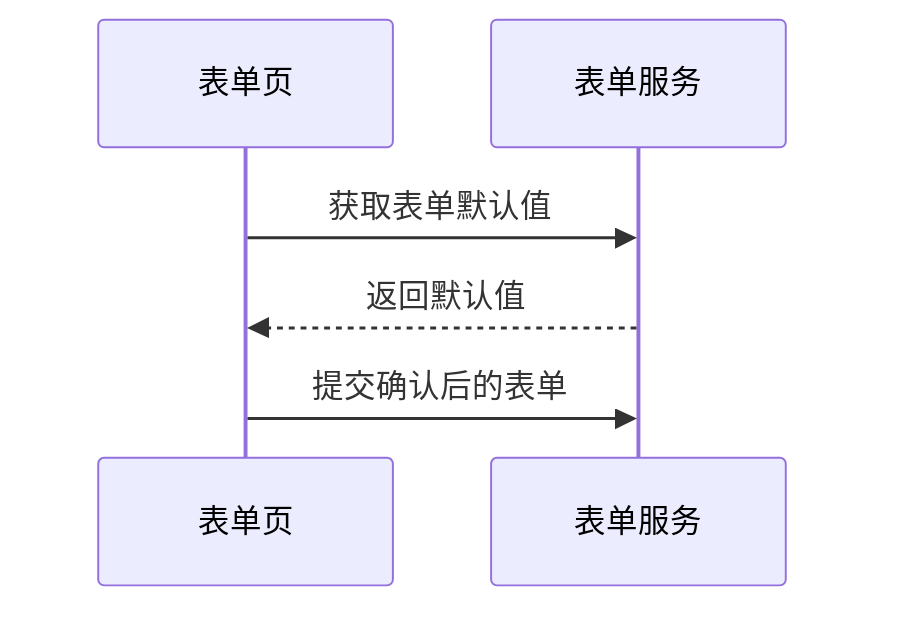

# feishu-doc

通过飞书开放平台 Open API 读取和写入飞书文档内容，输出结构化 JSON（包含 markdown 格式的文档内容）。

正文通过 `scripts/` 下的 Python 脚本读写。浏览器用于按需读取指定资源块，以及将 draw.io 导入画板。

## When to Use

- User provides a Feishu wiki/docx URL and needs the document content
- Reading Feishu documents as requirements or design references
- Writing or appending content to Feishu documents

## 调用方式

在 `feishu-doc` skill 根目录执行以下命令（`SKILL.md` 与 `scripts/` 同级）。

写入或清空文档前，确认用户已授权目标文档及操作。

### 技术方案配图

先按章节内容决定是否配图。文字或表格已经能讲清楚时，直接用正文。需要配图时按图要表达的内容选择命令。

| 任务 | 写入方式 |
| --- | --- |
| 流程、时序、状态 | 优先用 [Mermaid 围栏](#可编辑-mermaid-文本绘图)，随正文写入飞书文本绘图。已有 Mermaid 小组件需要更新时，编辑原小组件源码。 |
| 需要精确分层、分组和走线的复杂架构，或已有 `.drawio` 源文件 | 准备好 `.drawio` 源文件后直接走 [`import-drawio`](#导入-drawio-画板)。新增用 `--anchor` 定位章节，原位更新用 `--replace-block-id`。`--output` 指定本地回读截图。 |
| 用户明确要求把 PNG、JPG、SVG 等作为正文图片插入 | 本 Skill 的图片能力仅支持读取预览。若任务必须交付正文图片，说明当前入口的限制。 |

更新前用 `read` 的正文和 `assets` 定位同一章节、同一用途的已有图。仍准确就复用，需变更就原位更新并回读核对。匹配不唯一时先核对位置和图的内容，确认缺少对应图时才新增。用定点操作保留已有画板。

写入 draw.io 架构图时直接执行画板命令。图片上传和替换接口（`upload_all`、`replace_image`、`docx_image`、`drive/v1/medias`）不属于这条路径。命令报错时按[画板导入的回读与恢复说明](#导入-drawio-画板)处理。

首次使用可将 `assets/.feishu.example` 复制为 `assets/.feishu.local` 后在本机配置，也可使用下述环境变量。配置完成后按登录流程授权。

**读取文档**：
```bash
python3 scripts/index.py read "<Feishu_URL>"
```

**按需读取资源**：先用 `read` 定位 `assets`。正文已经足够，或清单为空时，直接使用正文结果。需要资源内容时，只选择任务涉及的 `blockId`：

```bash
python3 scripts/index.py read-asset "<Feishu_URL>" --block-id "<blockId>" --output /path/to/new-file.png
```

`read-asset` 通过现有文档 API 核对块，然后使用飞书专用 Chrome Profile。首次需要时在窗口手动登录，后续复用。浏览器操作需要 macOS 或 Linux、Node.js 20+ 和系统 Chrome。首次使用前在 Skill 根目录执行 `npm ci`。操作沿用飞书页面查看或下载权限。

- 图片和画板用 `.png` 获取可见截图，`mode` 为 `visible-preview`。内嵌电子表格也支持这种读取。画板和表格预览仅覆盖页面已渲染的内容。
- 多维表格默认自动定位当前网格中可见的数据单元格，复制为 TSV，`mode` 为 `clipboard`。用户只需给出文档链接和目标表。用 `read` 返回的 `assets`，结合章节、表格占位和顺序确定唯一的 `blockId`。省略 `--output` 时保存到私有临时目录，返回 `path`、`rowCount` 和 `columnCount`。可用 `.tsv` 路径指定保存位置。输出保留单元格文本和空值，范围受当前视图和可见行列限制。复制使用飞书页面权限，完成后恢复原剪贴板。
- Excel 附件的输出扩展名使用 `.xlsx` 或 `.xls`，且须与实际下载一致。页面有明确的下载控件时保存工作簿，`mode` 为 `download`。输出父目录须已存在，目标文件须为新文件。无法定位或下载时，报告该块失败并保留已读取的正文结果。

```bash
python3 scripts/index.py read-asset "<Feishu_URL>" --block-id "<blockId>"
```

需要缩小选区时可用 `--range X1,Y1:X2,Y2`，坐标是相对可见网格左上角的 CSS 像素。自动定位失败或复制行列数不一致时，命令报告失败。可用 `.png` 检查实际视图后重试。

### 导入 draw.io 画板

```bash
python3 scripts/index.py import-drawio "<Feishu_URL>" "/path/to/diagram.drawio" \
  --anchor "章节标题全文" --output "/path/to/new-preview.png" --yes
```

命令在唯一匹配的顶层正文标题后插入画板。追加到文末时用 `--append` 替换 `--anchor`。如果文末是画板、表格等非文本块，先在后面留一行空段落。标题以 `read` 返回的正文为准，自动编号可能只出现在网页上。命令用已有文档 API 读取位置，通过飞书专用 Chrome Profile 新建画板并选择本地 `.drawio`。需要浏览器账号有目标文档的编辑权限。仅对已授权的文档、位置和源文件使用 `--yes`。

飞书已保存新画板但页面未识别时，命令会回读文档块，核对目标位置和本次新增的唯一块 ID，再打开同一块。确认画板为空后直接导入。打开画板超时会重新滚动定位同一块并再试一次。位置有歧义、画板已有图形或上传结果未知时，先回读确认状态。

浏览器操作由 Skill 自带的 Playwright 和飞书专用 Chrome Profile 执行，无需启动 Computer Use。首次登录或会话失效时，在该 Chrome 窗口完成飞书登录。命令成功后会重新打开文档并保存画板 PNG，打开截图核对节点、文字和连线。参见[飞书画板导入说明](https://www.feishu.cn/hc/zh-CN/articles/018852745122-从外部导入内容至画板)。

已由 `.drawio` 源文件维护的画板可以原位更新。用 `read` 确认目标画板的 `blockId`，授权范围包括清空该画板的所有图形。

```bash
python3 scripts/index.py import-drawio "<Feishu_URL>" "/path/to/updated.drawio" \
  --replace-block-id "<blockId>" --output "/path/to/new-preview.png" --yes
```

飞书网页导入会追加图形。替换模式先检查源文件和导入入口，再全选并清空指定画板，随后导入新版。成功时返回原块 ID 和重新加载后的截图。画板上的手工补图会随旧图一起删除，更新前保留旧版 `.drawio` 源文件。飞书明确拒绝导入且画板仍为空时，命令会尝试撤销本次删除。遇到超时先回读该画板，结果未知时避免重跑。若画板确认为空，可在飞书网页打开同一画板，从「更多 → 导入」恢复旧版或导入修正后的文件。

**清空文档**（删除所有内容，写入前需先确认再清空）：
```bash
python3 scripts/index.py clear "<Feishu_URL>"
```

**写入文档**（覆盖更新：先清空再写入，第一个 H1 设为文档标题）：
```bash
python3 scripts/index.py write "<Feishu_URL>" "<content_file>"
```

**追加内容**（在文档末尾追加，不修改标题和已有内容）：
```bash
python3 scripts/index.py append "<Feishu_URL>" "<content_file>"
```

**定点插入**（按标题/文本定位，支持模糊匹配和正则；必须提供内容文件路径，不支持 stdin）：
```bash
python3 scripts/index.py insert-targeted "<Feishu_URL>" "<content_file>" \
  --anchor-type heading --anchor "技术方案" --match fuzzy --position section_end
```

**删除章节**（先删子章节/内容，再删标题）：
```bash
python3 scripts/index.py delete-section "<Feishu_URL>" \
  --anchor "技术方案" --match fuzzy
```

> ⚠️ `insert-targeted` 和 `delete-section` 默认都需要确认：会先输出预览，输入 `yes` 才执行。
> 非交互场景请显式传 `--yes`。

### 保留模板标题与编号

按模板编写或更新飞书文档时，先核对原模板中实际显示的目录和标题层级。Docx Open API 读取的标题文本可能省略飞书页面显示的自动编号。有 PDF 或其他带编号的模板副本时，用它核对编号。

通过本 Skill 的 Docx Open API 写入时，用 Markdown 标题层级表达目录，并把所需编号写在标题文本里。例如正文一级标题用 `# 3. 架构方案`，其子节用 `## 3.2 “4+1”视图模型` 和 `### 3.2.3 过程（进程）视图`。使用 `write` 时，正文前先放一个文档标题，因为命令会将第一个 H1 设为文档标题。若现有文档已开启飞书自动编号，先核对页面显示，再决定哪些标题需要显式编号，避免重复显示。

写入后回读核对标题文本、层级、顺序和正文交叉引用。需要验收自动编号或目录的页面显示时，另行核对飞书页面或导出副本。

### 可编辑 Mermaid 文本绘图

用 `write`、`append` 或 `insert-targeted` 写入 Markdown 文件时，显式标记为 `mermaid` 的围栏会插入飞书原生文本绘图小组件，默认显示图表。`read` 将小组件还原为 Mermaid 围栏。使用现有文档编辑权限即可插入。

````markdown

````

流程图可用分组表示系统边界，用带文字的连线区分调用和回流。时序图可用分支和注释说明失败路径。甘特图适合排期，饼图适合比例。飞书内可切换主题和代码／图表视图。使用新版 Mermaid 图种或语法前，先在飞书预览中确认渲染。见[飞书文本绘图小组件说明](https://www.feishu.cn/hc/zh-CN/articles/496118428959-使用文本绘图小组件)。

### 差异更新（snapshot / sync）

对支持范围内的正文和同结构表格，优先使用 `sync` 保留未变块。含文本绘图小组件的文档可用 `insert-targeted` 定点新增内容，已有图可在飞书中编辑源码。先读[差异更新说明](references/diff-sync.md)确认支持范围、基线及失败恢复边界。

```bash
python3 scripts/index.py snapshot "<Feishu_URL>" baseline.json
python3 scripts/index.py sync "<Feishu_URL>" desired.md --baseline baseline.json
# 已授权具体更新后：显式执行，状态文件必须不存在
python3 scripts/index.py sync "<Feishu_URL>" desired.md \
  --baseline baseline.json --apply --state sync-run.json
```

默认只预览，`--apply` 才写入；目标 Markdown 首行是 `# 文档标题`。第一版支持文本、标题、扁平列表、待办、代码块和同结构表格单元格；图片、复杂嵌套及表格结构变化会停止，不自动清空重写。写入结果不明时先核查快照和执行状态，不自动重发。新增命令不扩大用户对外部写入的授权。

## URL Format

支持格式：
- `https://xxx.feishu.cn/wiki/TOKEN`
- `https://xxx.feishu.cn/docx/TOKEN`

示例：`https://example.feishu.cn/wiki/EXAMPLE_TOKEN`

## 认证配置

> **环境变量优先**：脚本会优先读取 `FEISHU_APP_ID` / `FEISHU_APP_SECRET`，未设置时才读取 `assets/.feishu.local`，最后才读取模板 `assets/.feishu`。
> Skill 本身不会注入环境变量，请确保运行命令的终端/环境已设置这些变量。

支持两种认证方式，优先使用个人授权。

### 方式1：个人授权（推荐）

使用 `user_access_token`，能访问你个人有权限的所有文档，无需逐个授权。

**前置步骤**：
1. 在 https://open.feishu.cn/app 创建**企业自建应用**
2. 申请权限：`docx:document:readonly`、`docx:document`
3. 安全设置 → 重定向 URL → 添加 `http://127.0.0.1:9999/callback`
4. 发布应用

**首次登录**：
```bash
python3 scripts/login.py
```
浏览器会自动打开飞书授权页，点击授权后 token 自动保存。

- access_token 有效期 2 小时，脚本自动用 refresh_token 刷新
- refresh_token 有效期 30 天，过期后重新运行 `login.py`

**退出登录**：
```bash
python3 scripts/login.py logout
```

**重新登录**（token 过期或切换账号）：
```bash
python3 scripts/login.py logout && python3 scripts/login.py
```

### 方式2：应用授权

使用 `tenant_access_token`，需要将文档/知识库分享给应用。

**前置步骤**：同方式1的步骤1-2，然后在飞书中将文档「分享」给该应用。

### .feishu 格式

```
app_id=cli_xxxx
app_secret=xxxx
```

## 输出结构

**读取（read）**：
```json
{
  "docUrl": "https://...",
  "title": "文档标题",
  "blockCount": 42,
  "markdown": "# 文档标题\n\n文档内容...",
  "rawContent": "纯文本内容...",
  "assets": []
}
```

`assets` 从正文读取时已获取的文档块中提取。每项包含 `type`（`image`、`file`、`excel`、`sheet`、`bitable` 或 `whiteboard`）、`blockId`、`blockIndex`（从 1 开始的文档块顺序）和 `sectionPath`（标题路径）。文件名可见时附带 `name`，按 `.xlsx` 或 `.xls` 后缀识别 Excel。空数组表示未识别到这些块。需要读取内容时按上文使用 `read-asset`。

**清空（clear）**：
```json
{
  "docUrl": "https://...",
  "action": "clear",
  "blocksDeleted": 42,
  "status": "success"
}
```

**写入（write）**：
```json
{
  "docUrl": "https://...",
  "action": "write",
  "blocksAdded": 5,
  "status": "success"
}
```

**定点插入（insert-targeted）**：
```json
{
  "docUrl": "https://...",
  "action": "insert-targeted",
  "anchor": "技术方案",
  "position": "section_end",
  "blocksAdded": 3,
  "status": "success"
}
```

**删除章节（delete-section）**：
```json
{
  "docUrl": "https://...",
  "action": "delete-section",
  "anchor": "技术方案",
  "blocksDeleted": 8,
  "status": "success"
}
```

## 写入支持的格式

- 标题（H1~H9，第一个 H1 自动设为文档标题）
- 代码块（自动识别 Java、SQL、JSON、Python、Go、Shell、mermaid 等语言）
- 无序列表、有序列表
- 待办事项（`- [ ]` / `- [x]`）
- 引用（渲染为飞书 Callout 容器）
- 表格（每个 Markdown 表写成一张飞书原生表格，保留一行表头）。`write`、`append` 和 `insert-targeted` 先创建最多 9 行，再用 `insert_table_row` 在同一张表末尾追加剩余行，最后填入所有单元格。表格写入失败时停止，请回读文档核对已写入内容后再处理。
- 分割线
- 行内样式：**加粗**、`行内代码`、~~删除线~~、[超链接](url)

## 前置条件

- 需 python3（macOS/Linux 自带，Windows 需安装）
- 飞书开放平台应用需有目标文档的访问权限
